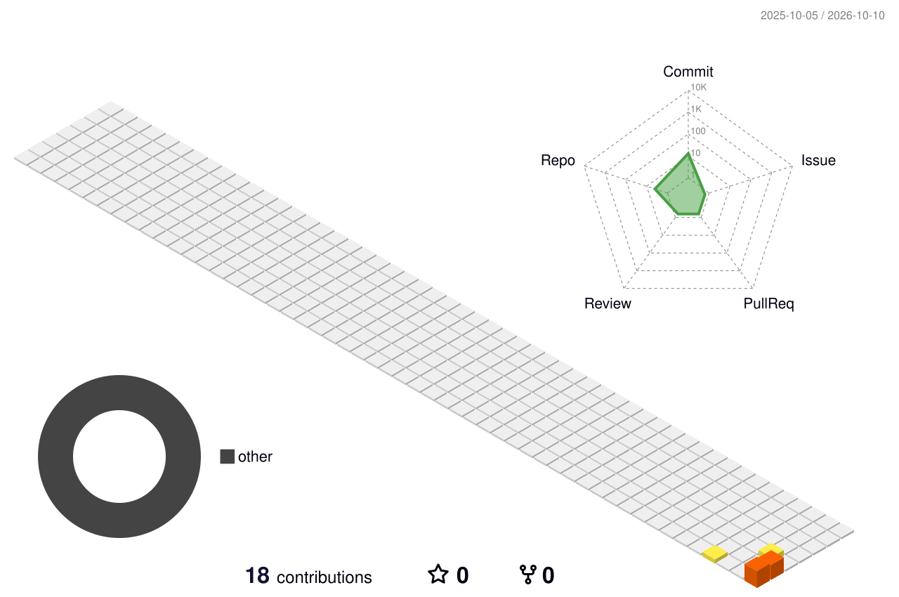

<div align="center">


<p>
  
  <a href="mailto:wearethirdnature@gmail.com"></a>
  
</p>

</div>

## ⚡ Mission Control

<table>
<tr>
<td width="50%" valign="top">

### `NOW.RUNNING`

- Building immersive web experiences
- Developing SaaS product systems
- Exploring desktop products for macOS & Windows
- Designing motion-first interfaces
- Shipping experiments under **Third Nature**

### `CURRENT.MODE`

```text
BUILDING      ██████████  active
EXPERIMENTING █████████░  active
SHIPPING      ████████░░  active
```

</td>
<td width="50%" valign="top">

### `SYSTEM.IDENTITY`

**Third Nature**  
Creative Developer · Full-Stack · SaaS

**Focus**  
Product engineering · Motion · Immersive UI · Systems

**Tagline**  
*For Things That Don’t Exist Yet.*

### `SIGNAL`

```text
web        ● online
saas       ● online
desktop    ● building
portfolio  ◌ coming soon
```

</td>
</tr>
</table>

## 🧬 Tech Matrix

<div align="center">


</div>

## 🚀 Selected Work

<table>
<tr>
<td width="33%" valign="top">

### 🌮 Casa Sombrero
**Immersive restaurant experience**

Cinematic desktop experience + mobile ordering flow with scene-driven interaction and motion.

`Next.js` `React` `TypeScript` `Three.js`

[Showcase](https://github.com/thirdnaturedev/casa-sombrero-showcase) · [Live](https://casa-sombrero.vercel.app)

</td>
<td width="33%" valign="top">

### 🛰️ Orbitail
**Web + desktop product**

A product spanning web, macOS and Windows experiences with active product engineering work.

`Desktop` `macOS` `Windows`

**Active development**

</td>
<td width="33%" valign="top">

### 🧩 SynapseHR
**Multi-tenant HRMS SaaS**

Employee operations, workflows, role-based access, payroll-oriented systems and scalable architecture.

`SaaS` `HR Tech` `Full Stack`

**In development**

</td>
</tr>
</table>

## 🌌 Contribution Universe

<div align="center">


<br/>



<br/>

<picture>
  <source media="(prefers-color-scheme: dark)" srcset="https://raw.githubusercontent.com/thirdnaturedev/thirdnaturedev/output/github-snake-dark.svg" />
  <source media="(prefers-color-scheme: light)" srcset="https://raw.githubusercontent.com/thirdnaturedev/thirdnaturedev/output/github-snake.svg" />
  
</picture>

</div>

## 📡 GitHub Telemetry

<div align="center">


<br/><br/>


</div>

## 📬 Connect

<div align="center">

<a href="mailto:wearethirdnature@gmail.com"></a>


<br/><br/>


</div>
